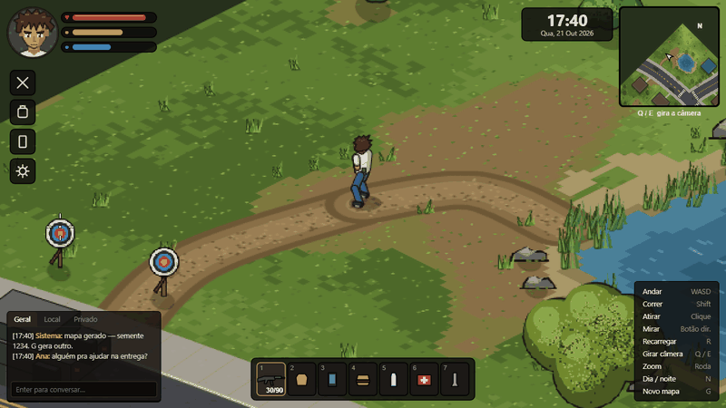

# City of God — piloto isométrico

Piloto de MMORPG isométrico (câmera 3/4) no navegador, feito só com **Canvas 2D**: sem WebGL, sem engine e sem imagens. Tudo é desenhado por código, no estilo Project Zomboid / GTA2 (formas chapadas de 2–3 tons com contorno de tinta).



## Como rodar

```bash
python -m http.server 4321
```

Abra `http://localhost:4321`. Use `?seed=1234` na URL para repetir um mapa.

## Alternância 2D / 3D (protótipo integrado)

O mesmo jogo oferece três visualizações: **Canvas 2D clássico**, **WebGL 3D
isométrico** e **WebGL 3D terceira pessoa**. Clique no botão `VISÃO: 2D`
(canto superior direito) ou pressione **V** para percorrer os três modos.

O 3D é desenhado em WebGL nativo (sem Three.js ou CDN), e deriva suas casas,
janelas, telhados, chão, ruas, árvores, cercas, lixeiras, personagens e
posições do mesmo mundo procedural do 2D. Movimento, colisão, objetos,
interações e horário do jogo continuam compartilhados. O modo 2D permanece
selecionável a qualquer momento. Se o navegador não oferecer WebGL, o jogo
continua em 2D.

O 3D atual é **um protótipo procedural low-poly**, não uma conversão automática
dos sprites artísticos 2D para modelos 3D de alta fidelidade. Alguns efeitos
visuais do 2D (por exemplo, textura de telhados, UI de mira e iluminação de
ambientes) ainda exigem aperfeiçoamento específico para o 3D.

Os modos disponíveis e seu comportamento:
- `V` ou botão de visualização: 2D → 3D ISO → 3D terceira pessoa → 2D
- `WASD`, `Shift`, `Q/E`, `F`, `R` e `N`: controles compartilhados
- Mouse: mirar/atirar, arrastar com botão do meio para girar câmera;
  roda altera o zoom dos modos
- O mapa e a posição do jogador não são reiniciados na troca

## Controles

| Ação | Tecla |
| --- | --- |
| Andar / correr | WASD / Shift |
| Atirar / mirar | Clique / botão direito |
| Recarregar | R |
| Girar câmera | Q / E (ou arrastar com o botão do meio) |
| Zoom | Roda do mouse |
| Dia / noite | N |
| Novo mapa | G |
| Chat | Enter |
| Alternar visualização 2D / 3D ISO / terceira pessoa | V ou botão VISÃO |

## Como funciona

- **Personagem:** esqueleto 3D invisível com IK de 2 ossos em braços e pernas, pintado em 2D. Animações por poses-chave com antecipação e recuperação (tiro, recuo, recarga com troca de carregador).
- **Mapa procedural:** gerado por semente — ruas curvas, terreno por ruído, florestas por densidade, lago, trilhas, e casas, carros e postes posicionados ao longo das ruas.
- **Desempenho:** chão, árvores, arbustos e pedras são pintados uma vez em canvas fora da tela; a cada quadro só o personagem, os tiros e o balanço do vento são animados.
- **Câmera estilo Zomboid:** segue o jogador, avança na direção da mira e gira em 90°. Paredes são cortadas ao entrar nas casas e telhados ficam translúcidos quando o jogador está atrás.

## Arquivos

- `js/core.js` — câmera, projeção isométrica, entrada e pincéis
- `js/world.js` — gerador do mapa, chão, vegetação e colisão
- `js/houses.js` — casas, móveis, cercas e carros
- `js/skeleton.js` — esqueleto, IK e animação
- `js/character.js` — pintura do personagem e retrato
- `js/hud.js` — HUD (retrato, barras, minimapa, hotbar, mira)
- `js/game.js` — laço principal, tiro, partículas e iluminação noturna
- `js/debug.js` — cenas de teste (`?scene=...`), carregado só para inspeção
